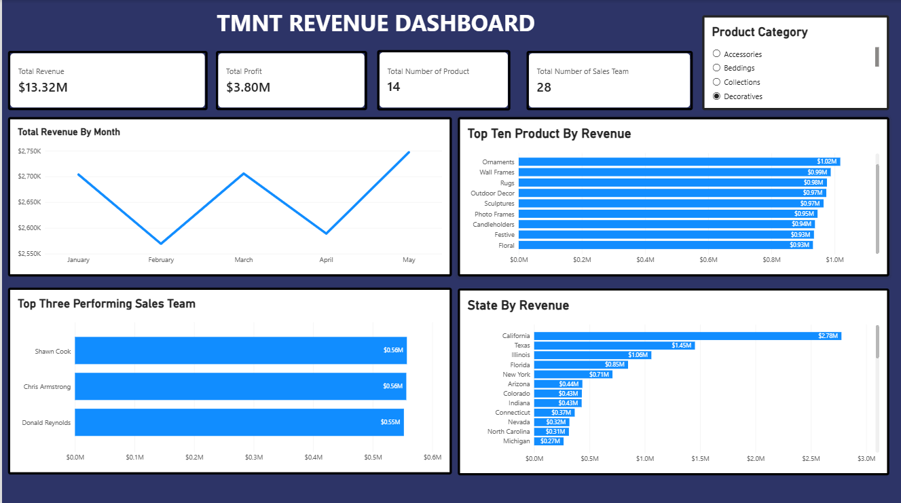

# TMNT Revenue Dashboard \| Power BI

An interactive **Power BI revenue and performance dashboard** designed
to turn sales data into clear, decision-ready insights. The report
brings revenue, profitability, product performance, sales-team results,
and geographic performance together in one view.

> **Project focus:** Business intelligence · Sales analytics · Revenue
> performance · Data visualization

## Dashboard Preview



*The dashboard screenshot is included in this repository. Keep
`tnmt_dashboard.png` in the same folder as this README so GitHub can
render the preview.*

## Project Overview

The TMNT Revenue Dashboard provides a high-level view of business
performance and allows users to explore results by **product category**.
It combines headline KPIs with monthly trends and ranked performance
visuals to make it easier to identify what is driving revenue.

The report is structured to help stakeholders quickly answer questions
such as:

-   How much revenue and profit has the business generated?
-   How does revenue change from month to month?
-   Which products contribute the most revenue?
-   Which sales-team members are the strongest performers?
-   Which states generate the highest revenue?
-   How does the selected product category affect the overall results?

## Key Performance Indicators

The dashboard highlights four headline metrics:

  KPI                              Dashboard value
  ------------------------------ -----------------
  Total Revenue                       **\$13.32M**
  Total Profit                         **\$3.80M**
  Number of Products                        **14**
  Number of Sales-Team Members              **28**

*Values are shown as displayed in the dashboard and reflect the current
report view.*

## Dashboard Components

  -----------------------------------------------------------------------
  Visual                              What it communicates
  ----------------------------------- -----------------------------------
  **Total Revenue by Month**          Tracks monthly revenue from January
                                      to May and makes changes in
                                      performance easy to spot.

  **Top Ten Products by Revenue**     Ranks products by revenue
                                      contribution to highlight leading
                                      product lines.

  **Top Three Performing Sales Team** Compares the three
                                      highest-performing sales-team
                                      members by revenue.

  **State by Revenue**                Shows how revenue is distributed
                                      across states and identifies
                                      leading markets.

  **Product Category Slicer**         Filters the report by category so
                                      users can explore performance
                                      within a selected product group.
  -----------------------------------------------------------------------

## Initial Observations

A quick review of the displayed dashboard suggests:

-   **May records the highest monthly revenue** among the months shown,
    while February is the lowest.
-   **Ornaments** is the leading product in the displayed Top Ten
    ranking.
-   **California** is the highest-revenue state in the displayed
    geographic ranking.
-   The top three sales-team members shown are **Shawn Cook, Chris
    Armstrong, and Donald Reynolds**.

These are descriptive observations from the dashboard view, not
conclusions about causes or future performance.

## Tools & Skills Demonstrated

-   **Microsoft Power BI** --- report design, KPI presentation,
    interactive filtering, and data visualization.
-   **Business and sales analysis** --- reviewing revenue, profit,
    product, team, and geographic performance.
-   **Dashboard storytelling** --- organizing multiple views into a
    single report for faster interpretation.
-   **Analytical communication** --- presenting key measures and
    rankings in a stakeholder-friendly format.

## How to Use the Dashboard

1.  Open the `.pbix` report in **Power BI Desktop**.
2.  Use the **Product Category** slicer to select a category.
3.  Review the KPI cards to understand the filtered revenue and profit
    position.
4.  Explore the monthly, product, sales-team, and state visuals to
    compare performance.

> **Note:** The interactive report requires the Power BI `.pbix` file.
> The image in this repository is a static preview of the dashboard.

## Repository Contents

``` text
TMNT-Revenue-Dashboard/
├── README.md
├── tnmt_dashboard.png
└── TMNT_Revenue_Dashboard.pbix   # Add your Power BI report file
```

## Project Status

`<sub>`{=html}Completed --- portfolio project.`</sub>`{=html}

## About This Project

This project demonstrates my ability to present business data in a
structured, accessible dashboard and translate multiple
sales-performance measures into a clear visual story. I welcome feedback
and opportunities to apply data analysis and Power BI skills to real
business problems.
